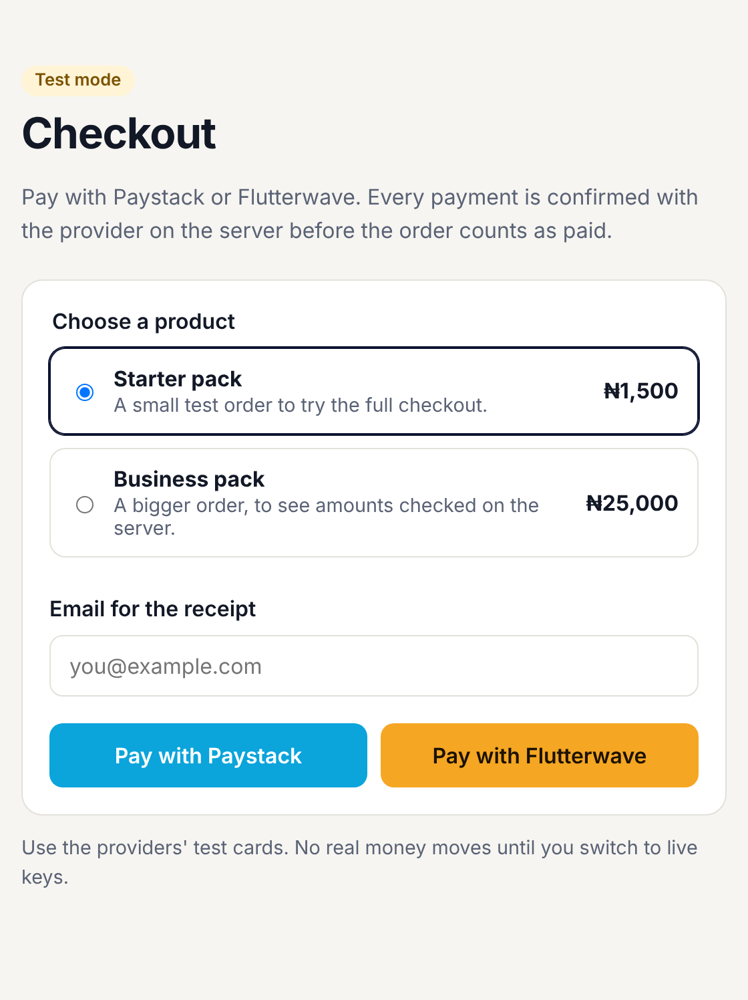

# Next.js Paystack + Flutterwave starter

Take payments in Nigeria with **Paystack** or **Flutterwave** in a Next.js app, and only mark an order paid after the provider confirms it **on the server**.

Most payment tutorials trust the redirect: Paystack or Flutterwave sends the shopper back with `?status=successful`, and the app marks the order paid. Anyone can type that URL. This starter never trusts the browser.

**Live demo (test mode):** [https://nextjs-paystack-flutterwave-starter.vercel.app](https://nextjs-paystack-flutterwave-starter.vercel.app). Pay with each provider's test card; no real money moves.



## What's inside

- **One checkout, two providers.** Pick a product, enter an email, pay with Paystack or Flutterwave.
- **Server-side prices.** The browser sends a product id, never an amount. Prices live in [`lib/catalog.ts`](lib/catalog.ts), in kobo.
- **Server-side verification.** After checkout, the app calls the provider's verify API and checks four things: the payment succeeded, the reference is ours, the currency is NGN, and the amount is at least the full price ([`lib/verify.ts`](lib/verify.ts)).
- **Webhooks with signature checks.** Paystack webhooks are checked with HMAC SHA-512 of the raw body; Flutterwave webhooks with your secret hash. Both use constant-time comparison ([`lib/signature.ts`](lib/signature.ts)). Even a signed webhook is re-verified with the API before fulfilling.
- **Fulfil once, even on serverless.** The redirect and the webhook can both arrive, more than once, on different server instances. With `DATABASE_URL` set, orders are recorded in Postgres with the reference as the primary key, so exactly one fulfilment wins ([`lib/orders.ts`](lib/orders.ts)).
- **Unsafe setups refuse to run.** Without a database, orders are kept in memory, which is fine locally and for test-mode demos. With live keys in production and no `DATABASE_URL`, the starter won't fulfil orders rather than risk fulfilling one twice.
- **Provider outages and rate limits handled.** If the verify API is down or answers 429, that is never read as a failed payment: the shopper sees "Still confirming", and the webhook answers 503 so the provider sends the event again later.
- **A reconciler for long outages.** Every payment is recorded as pending before the shopper pays. A scheduled job ([`lib/reconcile.ts`](lib/reconcile.ts)) re-verifies anything paid but never fulfilled, through the same `settle()` path, so an order can't be lost even if the provider stays down longer than its webhook retries. It backs off from a provider that is still down and gives up on checkouts abandoned for 3 days.
- **No secrets in the browser.** Keys are server-only environment variables, never `NEXT_PUBLIC_`.
- **45 tests** covering verification, rate limits, underpayment, wrong currency, forged references, webhook signatures, double fulfilment and reconciliation, including server instances racing on a real Postgres engine. No real network calls.

## Run it in 5 minutes

1. **Get test keys**
   - Paystack: [Dashboard](https://dashboard.paystack.com) > Settings > API Keys & Webhooks > **Test Secret Key** (`sk_test_...`)
   - Flutterwave: [Dashboard](https://dashboard.flutterwave.com) > Settings > API Keys, in **Test mode** (`FLWSECK_TEST-...`)
2. **Install and configure**
   ```bash
   git clone https://github.com/SamOpera/nextjs-paystack-flutterwave-starter.git
   cd nextjs-paystack-flutterwave-starter
   npm install
   cp .env.example .env.local
   ```
   Fill in `.env.local` with your test keys. `SITE_URL` is `http://localhost:3000` locally.
3. **Start it**
   ```bash
   npm run dev
   ```
   Open http://localhost:3000 and pay with a test card.

### Test cards

Use the cards from each provider's docs, which they keep up to date:

- Paystack: [paystack.com/docs/payments/test-payments](https://paystack.com/docs/payments/test-payments/)
- Flutterwave: [developer.flutterwave.com/docs/integration-guides/testing-helpers](https://developer.flutterwave.com/docs/integration-guides/testing-helpers)

## Webhooks

Webhooks confirm a payment even if the shopper closes the tab before the redirect. Providers can't reach `localhost`, so set these up on your deployed site (or through a tunnel such as ngrok while developing).

| Provider | Where | Value |
| --- | --- | --- |
| Paystack | Settings > API Keys & Webhooks > Test Webhook URL | `https://your-site.com/api/paystack/webhook` |
| Flutterwave | Settings > Webhooks > URL | `https://your-site.com/api/flutterwave/webhook` |
| Flutterwave | Settings > Webhooks > Secret hash | the same value as `FLW_SECRET_HASH` |

## Deploy on Vercel

1. Import the repo on [vercel.com/new](https://vercel.com/new).
2. Add the environment variables from `.env.example`, with `SITE_URL` set to your Vercel URL. For live payments, add `DATABASE_URL` too (see below).
3. Deploy, then add the webhook URLs above in each dashboard.
4. Add a `CRON_SECRET` (a random string of 16+ characters). Vercel sends it to `/api/reconcile`, and the route refuses every other caller. `vercel.json` runs the reconciler once a day, the most often the Hobby plan allows; on Pro, change the schedule to `*/10 * * * *`.

## How a payment flows

```
Browser                 Your server                       Provider
   | POST /api/checkout     |                                 |
   |  (product id, email)   |-- initialize (catalog price) -->|
   |<----- redirect --------|<------- checkout URL -----------|
   |------------------------ pays on provider's page -------->|
   |<------------------- redirect back with reference --------|
   | GET /api/.../callback  |-- verify by reference --------->|
   |                        |<-- status, amount, currency ----|
   |                        |  check, then fulfil once        |
   |<-- /result?status=... -|                                 |
   |                        |<== webhook (signed) ============|
   |                        |-- verify again, fulfil once --->|
```

## Going to production

- **Set `DATABASE_URL`** to any Postgres database, for example Supabase (use the transaction pooler URL), Neon or Vercel Postgres. The `fulfilled_orders` and `pending_payments` tables are created on first use. This is required with live keys: without it, checkout refuses to start payments and the reason is logged.
- **Deliver the goods where `fulfilOnce` returns true** in [`lib/orders.ts`](lib/orders.ts). That branch runs exactly once per payment.
- **Treat `/result` as a message, not proof.** It only displays what the server decided. Use your database as the record of what was paid.
- **Switch to live keys** in your host's environment variables only, and set the live webhook URLs.
- **Keep the amount check.** If you add discounts or a cart, calculate the total on the server and store it with the reference, then compare against that.

## Scripts

| Command | What it does |
| --- | --- |
| `npm run dev` | Start the dev server |
| `npm test` | Run the tests |
| `npm run typecheck` | Type-check |
| `npm run build` | Production build |

## License

MIT. Built by [Samson Olakeye](https://samsonolakeye.com) ([@TheSamOpera](https://x.com/TheSamOpera)). Issues and pull requests are welcome.
